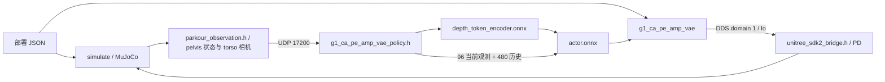

# G1 CA PE AMP VAE 右偏排查（2026-10-19）

在当前 C++ MuJoCo / UDP / ONNX / DDS / PD 闭环中复现了前进右偏，主要表现为负 yaw 角速度持续积累，而不是持续向机器人右侧平移。现有证据不支持把问题归因于命令行参数或 JSON 的左右关节配置；也不足以单独证明训练策略本身有问题，仍需区分策略的航向跟踪能力和跨仿真器差异。

## 项目与控制链路

完整目录说明见 [project_structure.md](project_structure.md)。本任务链路为：



- `example/cpp/g1_ca_pe_amp_vae.cpp`：选择策略适配器，复用 `g1_visual_controller.h` 状态机与手柄/键盘输入。
- `g1_visual_config.h`：29 关节训练顺序到 DDS 顺序映射、方向、默认角、PD、动作缩放。
- `g1_ca_pe_amp_vae_policy.h`：当前观测、VAE 本体历史、深度预处理与历史、双网络推理、动作反馈。
- `simulate/src/parkour_observation.h`：同一 JSON 下的关节、机体系状态、射线深度和力矩限制。
- `unitree_robots/g1/`：MJCF 动力学、接触与视觉几何。
- `example/exported/g1_CA_PE_AMP_VAE/`：训练参数快照、部署 JSON、两个 ONNX。
- `example/cpp/tests/`：临时构建、调用正式控制器的离线及无界面闭环检查。

## 配置核对

`python3 example/cpp/tools/export_ca_pe_config.py --check` 通过：JSON 与保存的 `params/env.yaml`、`params/agent.yaml` 一致。

| 项目 | 核对结果 |
| --- | --- |
| 根状态 | pelvis；相机仍在 torso_link，与本任务定义一致 |
| 关节 | pelvis 根广度优先顺序；映射与训练仓库 symmetry.py 一致；方向全部 +1 |
| 默认角 / PD / action scale | 从训练快照逐关节提取；左右对应配置一致，肩 roll 默认角为镜像 |
| 周期 | 物理 0.005 s，策略 0.02 s |
| 网络输入 | 当前 96，历史 480，深度 8×32×32 → 64×64 token |
| 观测尺度 | 角速度 0.2、关节速度 0.05；命令不额外缩放 |
| 深度 | 裁剪、Gaussian blur、归一化和历史抽样与快照一致；像素射线方向与本机 IsaacLab 源码一致 |
| 动作 | ±100 裁剪，默认角 + 每关节 scale × action，再映射至 DDS |
| 模型 | SHA256 与任务 README 记录一致；实际双网络加载和推理通过 |

用户命令中的 domain、port 只控制通信；`--reset-seconds 3` 控制关节初始化插值时间，不会在策略运行时注入横移或 yaw 命令。
启动策略和复位时速度均清零，键盘 w 只增加 x；没有发现固定的负 y 或负 yaw 偏置。控制器默认启用手柄，但本次复现通过 `--no-gamepad` 排除了手柄影响。

仿真器也必须显式读取本任务 JSON：

```bash
./simulate/build/unitree_mujoco -r g1 -s scene_29dof_flat.xml -i 1 -n lo \
  --parkour --parkour-config example/exported/g1_CA_PE_AMP_VAE/g1_ca_pe_amp_vae_cfg.json
```

只传 `--parkour` 时，仿真器默认使用旧 g1_parkour JSON，不能作为本任务的配套启动方式。
用户现场的仿真启动命令尚未提供，因此不能确认现场与本次受控复现完全相同。

## 已修正的部署差异

沿训练快照中的函数引用检查本机训练仓库发现：

- 当前 `policy.actions` 使用 IsaacLab `last_action()`，返回 `action_manager.action`。
- `ActorHistoryObservation._actor_frame()` 使用 `action_manager.prev_action`。
- IsaacLab `process_action()` 先把旧 action 复制到 prev_action，再设置新 action。

因此历史帧的动作应比当前观测中的动作再旧一拍。原 C++ 将同一个 96 维当前帧直接追加到历史，丢失了这个区别。现已分别保存两拍动作，并新增连续两次推理的行为检查；复位清空两者。
这是与当前可读训练实现对齐的修正。参数 YAML 不保存函数源码，未独立确认训练 checkpoint 产生当天的函数版本。

正式 `g1_ca_pe_amp_vae` 已重新构建。该修正没有消除右偏，不能将其称为右偏根因或已解决右偏。

## 实测与对照

测试调用正式控制器，使用真实 C++ MuJoCo、UDP、ONNX、DDS、每物理步 PD；关闭手柄，在平地无挂带状态测量。策略从模拟固定基座启动后落地，初始化插值使用测试入口的 0.5 秒，落地约 8 秒。前进从 0.1 递增至 0.5 m/s，4.5～9 秒统计机体系平均速度，9 秒清零。

| 条件 | 平均 vx (m/s) | 平均 vy (m/s) | 平均 wz (rad/s) |
| --- | ---: | ---: | ---: |
| 原控制器 / 原 MJCF，前进 | 0.5061 | -0.0080 | -0.1527 |
| 原控制器 / 仅改盒状脚底，前进 | 0.5048 | -0.0089 | -0.1520 |
| 原控制器 / 仅改髋 roll 上限 139 Nm，前进 | 0.5049 | -0.0088 | -0.1488 |
| 修正动作历史 / 原 MJCF，前进 | 0.5082 | -0.0106 | -0.1609 |
| 修正动作历史 / 深度只看地面，前进 | 0.5177 | -0.0092 | -0.1665 |
| 修正动作历史 / 原 MJCF，零速站立 | 0.0100 | -0.0011 | +0.0035 |

原控制器前进测试在 t=9 s 的 XY 约 (2.375, -0.561) m，yaw 约 -32.8°。修正后的落地瞬态不同，绝对 yaw 也不同；应比较稳态角速度，不能把最后的绝对角度变化直接视为改善。
零速站立最大水平漂移原版约 6.0 cm、修正后约 6.7 cm，未复现持续右侧平移。
每个对照为一次受控运行，不提供统计显著性结论。

深度只看地面对照保持原 MJCF 动力学不变，将临时机器人所有 geom 分到组 1，
配合临时 JSON 的 `include_robot=false` 只对组 0 的地面射线采样，避免把碰撞几何误当作“无自身遮挡”。
右偏仍然存在，因此自身视觉遮挡不是产生右偏的必要条件；这不等于证明所有深度观测均与训练一致。

发现但未直接改动的模型差异：

1. 当前训练 URDF 的脚底是中心 (0.039,0,-0.03)、全尺寸 (0.20,0.07,0.01) m 的盒体；正式 MJCF 是四个半径 0.005 m 的球。仅替换脚底没有消除右转。URDF 不是本任务目录内的版本化快照，不能据此证明 checkpoint 当时使用的精确脚底模型。
2. 训练 JSON 的左右 hip roll 力矩上限为 139 Nm，MJCF joint actuatorfrcrange 和 motor ctrlrange 均为 ±88 Nm；发送器取两者最小值，所以实际仍是 88 Nm。仅在临时副本将两层上限改为 ±139，也没有消除右转。
3. PhysX 隐式执行器与 MuJoCo 显式逐步 PD、接触求解、几何与射线自遮挡存在剩余差异。配置数字一致不代表两个闭环等价。

## 检查范围与下一步

本次通过部署参数核对、双网络离线检查、正式目标构建与 `--check-policy`，以及修正前后的站立/前进和临时模型对照。测试仍以不倒地和有前进位移作为通过标准，**通过不代表直线跟踪合格**。

建议下一步使用原训练环境、同一 checkpoint/导出策略，在固定 `(0.5,0,0)`、关闭目标点导航反馈的条件下记录稳态 yaw 角速度：

- 若训练环境同样持续右转，检查策略 yaw 跟踪、VAE 状态估计、训练时的对称性与目标导航反馈依赖。
- 若训练环境能直行，重点对齐部署输入与动力学；用同一批记录观测比较 Python 和 C++ 推理，再比较相机深度和接触/执行器。

当前 actor 只接收机体系角速度、重力与速度命令等输入，没有绝对航向观测；零 yaw 速度命令也不等于绝对航向锁定。部署只执行手动速度命令，没有复现训练中的目标点导航反馈。
不建议用固定正 yaw 或修改左右默认角来掩盖偏差。

可复现入口：

```bash
python3 example/cpp/tests/run_tests.py --test ca-pe --verbose
python3 example/cpp/tests/run_tests.py --test ca-pe-sim --sim-mode ground --sim-mode walk --verbose
# 临时对照文件由调用方负责清理；测试构建总是自动清理
python3 example/cpp/tests/run_tests.py --test ca-pe-sim --sim-mode walk \
  --sim-scene /path/to/scene.xml --sim-config /path/to/config.json --verbose
```

本次正式 JSON、ONNX、MJCF 未改动；新增运行遥测与临时场景/配置覆盖入口，保留训练动作时序修正与行为测试。临时构建和对照副本在排查结束后清理，正式 build 不放置测试产物。
